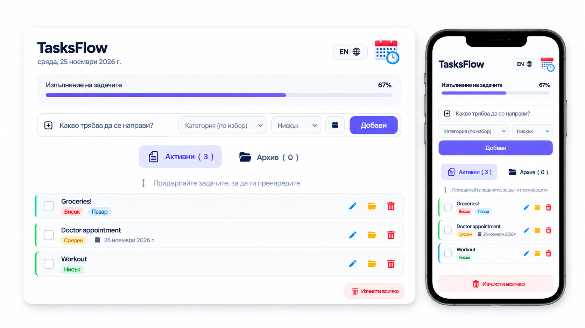

<h1 align="center">
  
  <a href="https://lyuboslava1.github.io/TaskFlow/" target="_blank">
    TasksFlow
  </a>
</h1>

### Organize • Focus • Achieve

TasksFlow is a simple and easy to use task manager that helps you keep track of your daily tasks, stay organized, and get things done without losing focus.

## Features

- **Task Management** — Create, edit, complete, archive, restore, and delete tasks.
- **Categories & Priorities** — Organize tasks and set their priority levels.
- **Due Dates** — Set deadlines and keep track of upcoming tasks.
- **Progress Tracking** — Visualize completed tasks with a progress bar.
- **Drag & Drop** — Reorder tasks with drag-and-drop functionality.
- **Active & Archived Tasks** — Keep your workspace organized.
- **Spotify Integration** — Listen to your favorite playlists while working.
- **Multilingual Support** — Switch between Bulgarian and English.
- **Local Storage** — Save tasks and preferences in your browser.
- **Responsive Design** — Adapted for desktop, tablet, and mobile devices.

## Built With

- HTML5
- CSS3
- JavaScript

## Responsive Design

TasksFlow is built to work well on all screen sizes, whether you're using a computer, tablet, or phone.

## Author

Created by **Lyuboslava Ivanova** 

💻 Frontend Developer | HTML • CSS • JavaScript • React
